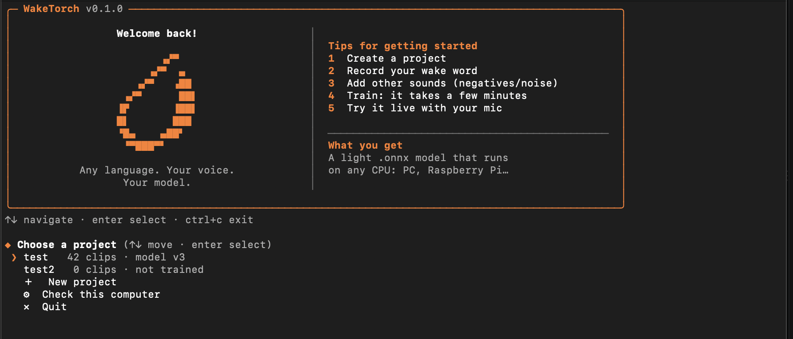

<div align="center">

# WakeTorch

### Train your own wake word model in minutes — in any language.

Guided CLI · Real voice samples · Fast training · ONNX export · Open source
Local · Lightweight

 
 
 
 
 
 
 


**Any language. Your voice. Your wake word.**

[Model & Documentation](https://alejandrolopezdata.github.io/waketorch/) | 
[Usage Tutorial](#usage-tutorial)</div>


## Why WakeTorch?

> **You shouldn't have to rack your brain to train a wake word.**

* **Any language** — train the wake word you actually want, in the language you actually speak.
* **Minutes, not hours** — the guided CLI takes you from recordings to a working model in minutes.
* **Yours from start to finish** — local training, local inference, no cloud required.
* **One model, everywhere** — export to ONNX and run lightweight inference on CPU.



## Installation

**Requirements:** [Python](https://www.python.org/downloads/) 3.10+ (3.12 recommended) and a microphone (if you want to record directly).

### 1. Download

Download the ZIP from [GitHub](https://github.com/alejandrolopezdata/waketorch) (**Code → Download ZIP**) and unzip it,
or clone it:

```bash
git clone https://github.com/alejandrolopezdata/waketorch.git
```

### 2. Install

**macOS / Linux**

```bash
cd ~/Downloads/waketorch-main
chmod +x install.sh
./install.sh
```

**Windows** (Command Prompt)

```bat
cd Downloads\waketorch-main
install.bat
```

You can also just double-click `install.bat` in the unzipped folder.

### 3. Run

Open a **new** terminal and type:

```bash
waketorch
```

### Uninstall

`./install.sh uninstall` (macOS / Linux) or `install.bat uninstall` (Windows). Your projects are not touched.

## Hardware

You don't need a powerful computer. Training is the heavy part; once you have the `.onnx` file, any computer can run it on the CPU.
* **NVIDIA GPU:** highly recommended.
* **Generic GPU:** recommended.
* **Mac with Apple Silicon:** recommended.
* **CPU only:** works, but training is slower.

Not sure about yours? Run the device check (about a minute):


* It detects your CPU, GPU, and RAM, runs a short benchmark, and recommends the best parameters for your system.

## Usage Tutorial

Once WakeTorch is installed, run `waketorch` and follow these steps. The whole process takes just a few minutes.

### 1. Create a project

Start by creating a new project. Everything you record, upload, and train will be stored there. Once it's created, open it to start working on your wake word.


### 2. Record or upload your audio

Your model learns from three types of audio. You can record them directly from the CLI or upload files you already have.


#### Wake word

Your target wake word, and nothing else. Record or upload **30–50 clips**, ideally with a bit of variety in tone, speed, and distance from the microphone.

#### Negatives

Random words and words that sound similar to your wake word, so the model learns what *not* to react to. Try to keep the clips about the same length as your wake word clips.

> **Tip:** Need ideas? Ask ChatGPT or any other LLM:
>
> *"Give me 30–50 random words and other words similar to (my_wakeword)."*

#### Noise

Record a long sample, a few minutes at least. It can include background noise, people talking, music, and so on. This audio is mixed with your wake word and negative clips during training, which makes the model more robust in real-world environments.

### 3. Train your model

Start the training. **2000 steps** is a good starting point.

Not sure which parameters suit your computer? Run the device check and WakeTorch will recommend the best settings for your hardware.


When training finishes, you can:

1. **Check the results** and the training curve.

2. **Test it with your mic.** Choose *"4. Try the model with the mic"*, then say random words and your wake word to see how it responds.

3. **Export your `.onnx` file.** Choose *"5. How to use my model"* to get a ready-to-use example of how to run it.

That's it: your wake word, your language, running locally.