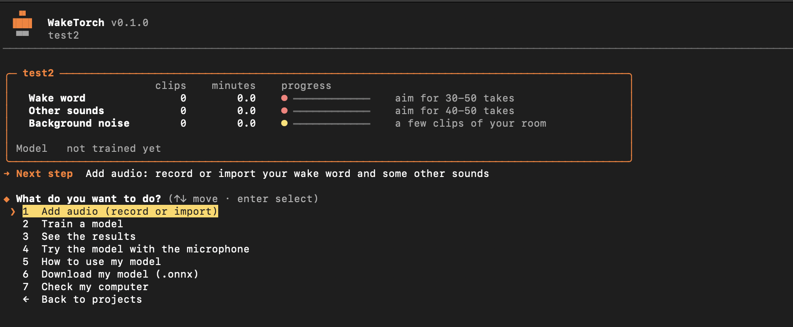
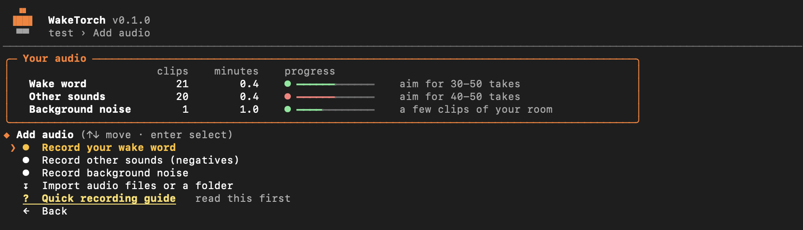
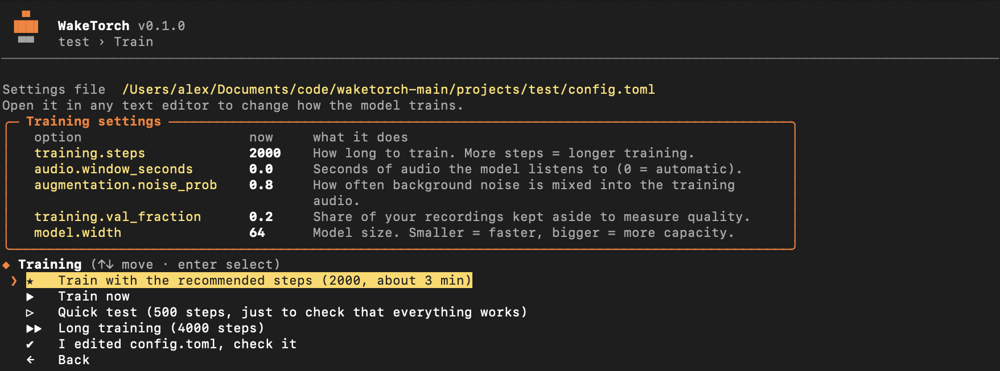
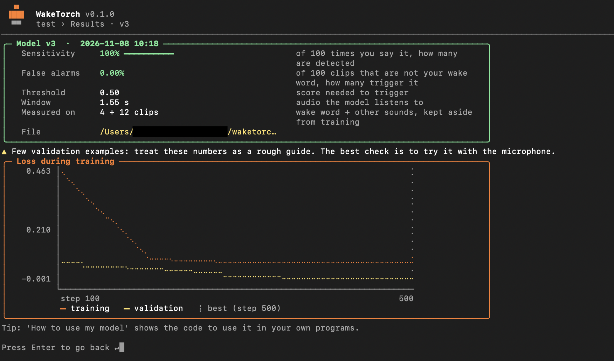
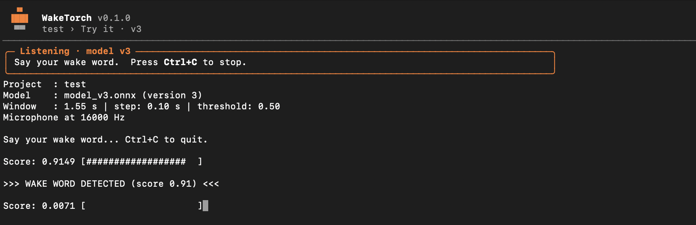

<div align="center">

# WakeTorch

### Train your own wake word model in minutes — in any language.

Guided CLI · Real voice samples · Fast training · ONNX export · Open source
Local · Lightweight

 
 
 
 
 
 
 


**Any language. Your voice. Your wake word.**

[Model & Documentation](https://alejandrolopezdata.github.io/waketorch/) | 
[Usage Tutorial](#usage-tutorial)</div>

## Table of Contents

- [Why WakeTorch?](#why-waketorch)
- [Installation](#installation)
- [Hardware](#hardware)
- [Usage Tutorial](#usage-tutorial)
- [Model size  & performance](#model-size--performance)
- [Contributing](#contributing)
- [License](#license)

## Why WakeTorch?

> **You shouldn't have to rack your brain to train a wake word.**

* **Any language** — train the wake word you actually want, in the language you actually speak.
* **Minutes, not hours** — the guided CLI takes you from recordings to a working model in minutes.
* **Yours from start to finish** — local training, local inference, no cloud required.
* **One model, everywhere** — export to ONNX and run lightweight inference on CPU.

## How does WakeTorch compare?

WakeTorch is not trying to replace every wake word tool. It focuses on one thing: getting **your** wake word, in **your** language, trained on **your** computer with the least friction.

| | **WakeTorch** | openWakeWord | microWakeWord | Picovoice Porcupine |
|---|---|---|---|---|
| **How you train** | Guided CLI, step by step | Python pipeline or Colab notebook | Python / TensorFlow pipeline | Web console |
| **Data you provide** | Your own voice: 30–50 clips (record or upload) | None: synthetic speech from a text-to-speech model | None: synthetic speech from a text-to-speech model | None: you type the phrase |
| **Where training runs** | Your computer, no account | Colab or your own machine | Colab or your own machine | Picovoice's servers, account required |
| **Setup effort** | One installer, then `waketorch` | Notebook or repo, dependencies, config to edit | Aimed at advanced users | Sign up and type a phrase |
| **Time to a first model** | Minutes | Roughly 1–2.5 hours on Colab | ~20 minutes on a free Colab GPU | Seconds |
| **Languages** | Any, because it learns from your voice | Those supported by the TTS voices | Those supported by the TTS voices | 17 supported languages |
| **What you get** | `.onnx` + a ready-to-run Python example | `.onnx` / `.tflite` | Tiny `.tflite` + JSON manifest | Platform-specific model file |
| **Cost / license** | Free, Apache-2.0 | Open source | Open source | Free tier ended June 30, 2026 |
| **Best for** | A personal wake word, fast, on desktop, Raspberry Pi or your own app | Home Assistant and generic phrases | ESP32 and microcontrollers | Commercial products with vendor support |

**What makes WakeTorch different**

* **Your voice, not a synthetic one.** The model learns from real recordings of you, in your accent and your language.
* **Everything in one place.** Record, train, check the curve, test with your microphone and export, all inside the same CLI.
* **Local from start to finish.** No cloud, no account, no notebook to babysit.
* **Straight to code.** The CLI gives you a ready-to-run example for your `.onnx` file.

*Comparison based on public documentation, last checked November 2026. These tools change often, so check each project for current details.*

## Installation

**Requirements:** [Python](https://www.python.org/downloads/) 3.10+ (3.12 recommended) and a microphone (if you want to record directly).

### 1. Download

Download the ZIP from [GitHub](https://github.com/alejandrolopezdata/waketorch) (**Code → Download ZIP**) and unzip it,
or clone it:

```bash
git clone https://github.com/alejandrolopezdata/waketorch.git
```

### 2. Install

**macOS / Linux**

```bash
cd ~/Downloads/waketorch-main
chmod +x install.sh
./install.sh
```

**Windows** (Command Prompt)

```bat
cd Downloads\waketorch-main
install.bat
```

You can also just double-click `install.bat` in the unzipped folder.

### 3. Run

Open a **new** terminal and type:

```bash
waketorch
```

### Uninstall

`./install.sh uninstall` (macOS / Linux) or `install.bat uninstall` (Windows). Your projects are not touched.

## Hardware

You don't need a powerful computer. Training is the heavy part; once you have the `.onnx` file, any computer can run it on the CPU.

* **NVIDIA GPU:** highly recommended.
* **Generic GPU:** recommended.
* **Mac with Apple Silicon:** recommended.
* **CPU only:** works, but training is slower.

Not sure about yours? Run the device check (about a minute):


* It detects your CPU, GPU, and RAM, runs a short benchmark, and recommends the best parameters for your system.

## Usage Tutorial

Once WakeTorch is installed, run `waketorch` and follow these steps. The whole process takes just a few minutes.

### 1. Create a project

Start by creating a new project. Everything you record, upload, and train will be stored there. Once it's created, open it to start working on your wake word.



### 2. Record or upload your audio

Your model learns from three types of audio. You can record them directly from the CLI or upload files you already have.



#### Wake word

Your target wake word, and nothing else. Record or upload **30–50 clips**, ideally with a bit of variety in tone, speed, and distance from the microphone.

#### Negatives

Random words and words that sound similar to your wake word, so the model learns what *not* to react to. Try to keep the clips about the same length as your wake word clips.

> **Tip:** Need ideas? Ask ChatGPT or any other LLM:
>
> *"Give me 30–50 random words and other words similar to (my_wakeword)."*

#### Noise

Record a long sample, a few minutes at least. It can include background noise, people talking, music, and so on. This audio is mixed with your wake word and negative clips during training, which makes the model more robust in real-world environments.

### 3. Train your model

Start the training. **2000 steps** is a good starting point.

Not sure which parameters suit your computer? Run the device check and WakeTorch will recommend the best settings for your hardware.



### 4. Test and export your model

When training finishes, you can:

1. **Check the results** and the training curve.

   
   > **Note:** The example screenshots (training and results) are not a good reference for how many clips you need. They come from a model trained with just **21 wake word samples and 20 negatives**. It still works quite well, but with so few clips the validation set is tiny and the metrics are only a rough guide. For more reliable results, use the recommended **30-50 wake word clips** and a good variety of negatives.

2. **Test it with your mic.** Choose *"4. Try the model with the mic"*, then say random words and your wake word to see how it responds.

   

3. **Export your `.onnx` file.** Choose *"5. How to use my model"* to get a ready-to-use example of how to run it. First, install the dependencies:

   ```bash
   pip install numpy onnxruntime sounddevice
   ```

   Then run this script to listen to your microphone and detect your wake word:

   ```python
   import json
   import time

   import numpy as np
   import onnxruntime as ort
   import sounddevice as sd

   MODEL_PATH = "model_v1.onnx"

   session = ort.InferenceSession(MODEL_PATH, providers=["CPUExecutionProvider"])
   info = json.loads(session.get_modelmeta().custom_metadata_map["wakeforge"])
   input_name = session.get_inputs()[0].name

   sample_rate = info["input"]["sample_rate"]
   window = info["window_samples"]

   threshold = info["threshold"]  # Auto = 0.5, you can adjust this value to make the detection more or less sensitive
   # Example thresholds:
   # threshold = 0.7  # Less sensitive
   # threshold = 0.4  # More sensitive

   step = int(0.1 * sample_rate)

   buffer = np.zeros(window, dtype=np.float32)
   ready, last_hit = True, 0.0

   print("Listening... press Ctrl+C to stop.")
   try:
       with sd.InputStream(samplerate=sample_rate, channels=1, dtype="float32", blocksize=step) as mic:
           while True:
               chunk, _ = mic.read(step)
               buffer = np.concatenate([buffer[step:], chunk[:, 0]])
               score = float(session.run(None, {input_name: buffer[None, :]})[0][0])

               if not ready and score < threshold / 2 and time.time() - last_hit > window / sample_rate:
                   ready = True
               if ready and score >= threshold:
                   ready, last_hit = False, time.time()
                   print(f"Wake word detected! (score {score:.2f})")
   except KeyboardInterrupt:
       print("Stopped.")
   ```

That's it: your wake word, your language, running locally.

## Model size & performance

WakeTorch models are tiny. A trained model is a single `.onnx` file of about **1.3 MB**, smaller than a typical phone photo.

| | Apple M2 (1 CPU thread) |
|---|---|
| File size | 1.28 MB |
| Parameters | 315 K |
| Time per check | ~2 ms |
| CPU while listening | ~7.5% of one core |
| Memory (minimal app) | ~58 MB total, ~13 MB for the model |

**What this means in plain words**

* **Light on disk:** 1.3 MB is easy to ship inside any app or device.
* **Light on the CPU:** the model checks the audio 10 times per second. Each check takes about 2 ms, and a real listening loop uses roughly 7.5% of a single core, so it never needs a GPU.
* **Light on memory:** most of the ~58 MB is Python and ONNX Runtime. The model itself adds about 13 MB.
* **Room to spare:** it uses ~7.5% of one CPU core, so even a core several times slower should handle it.

*Measured with [`tests/onnx_test.py`](tests/onnx_test.py) on an Apple M2, 1 thread, onnxruntime 1.31.1. The estimate for slower devices assumes time scales with core speed. Results on your hardware will vary, so run the script to check.*

## Contributing

Contributions are welcome! Whether it's a bug report, a new idea, or a pull request, you're invited to help improve WakeTorch.

* **Found a bug?** [Open an issue](https://github.com/alejandrolopezdata/waketorch/issues/new) and include your OS, Python version, and steps to reproduce it.
* **Have an idea?** [Open an issue](https://github.com/alejandrolopezdata/waketorch/issues/new) and tell us what you'd like to see.

## License

WakeTorch is licensed under the [Apache License 2.0](LICENSE).