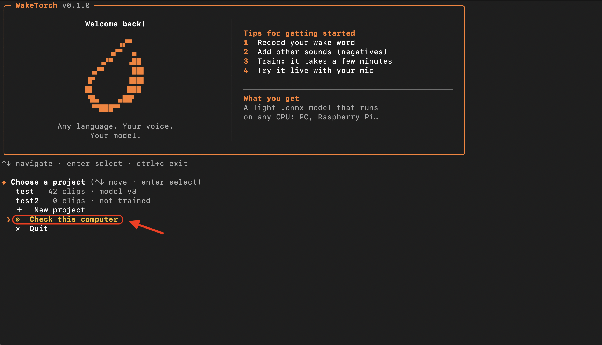

<div align="center">

# WakeTorch

### Train your own wake word model in minutes — in any language.

Guided CLI · Real voice samples · Fast training · CPU inference · ONNX export  
Open source · Local · Lightweight

 
 
 
 
 
 
 

**WORK IN PROGRESS — This project is still under active development.**

WakeTorch is an early-stage project. Features, functionality, and documentation
may change as development progresses. Bugs and incomplete features are expected.

**Any language. Your voice. Your wake word.**

[Model & Documentation](https://alejandrolopezdata.github.io/waketorch/)

</div>


## Why WakeTorch?

> **You shouldn't need a huge dataset, a GPU, or a PhD to train a wake word.**

* **Any language** — train the wake word you actually want, in the language you actually speak.
* **Minutes, not hours** — the guided CLI takes you from recordings to a working model in minutes.
* **Your voice, not synthetic TTS** — train on real recordings for a truly personal wake word.
* **Less data, more signal** — built-in augmentation makes small datasets go further.
* **One model, everywhere** — export to ONNX and run lightweight inference on CPU.
* **Yours from start to finish** — local training, local inference, no cloud required.


## Installation

**Requirements:** [Python](https://www.python.org/downloads/) 3.10+ (3.12 recommended; on Windows, tick **Add python.exe to PATH** when installing) and a microphone.

### 1. Download

Download the ZIP from [GitHub](https://github.com/alejandrolopezdata/waketorch) (**Code → Download ZIP**) and unzip it,
or clone it:

```bash
git clone https://github.com/alejandrolopezdata/waketorch.git
```

### 2. Install

**macOS / Linux**

```bash
cd ~/Downloads/waketorch-main
chmod +x install.sh
./install.sh
```

**Windows** (Command Prompt)

```bat
cd Downloads\waketorch-main
install.bat
```

You can also just double-click `install.bat` in the unzipped folder.

### 3. Run

Open a **new** terminal and type:

```bash
waketorch
```

### Uninstall

`./install.sh uninstall` (macOS / Linux) or `install.bat uninstall` (Windows). Your projects are not touched.

## Hardware

You don't need a powerful computer. Training is the heavy part; once you have the `.onnx` file, any computer can run it on the CPU.

* **Mac with Apple Silicon:** recommended. Uses the Apple GPU automatically (a 500-step test takes about 36 seconds on an M2).
* **NVIDIA GPU:** expected to work well.
* **CPU only:** works, but training is slower.

Not sure about yours? Run the device check (about a minute):



It detects your CPU, GPU and RAM, runs a short benchmark, and tells you how many training steps your computer can do in 10 minutes, up to the standard 2000. On slower machines it recommends fewer steps so training stays short.
